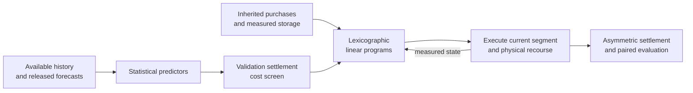

<div align="center">

# Decision-aware Microgrid Recourse

**A reproducible companion for inherited-plan electricity procurement, causal forecasting, and lexicographic linear programming**

Python 3.11 · SciPy/HiGHS · scikit-learn · PyTorch · MATLAB

[Quick start](#quick-start) · [Experiments](#reproduce-the-experiments) · [Results](#reference-results) · [Data](docs/DATA.md) · [Model](docs/MODEL.md) · [中文说明](README.zh-CN.md)

</div>

---

This archive accompanies **Decision-aware receding-horizon linear programming for residential microgrids under asymmetric electricity settlement**. It contains the complete supplied dataset export, unchanged computational source, saved experiments, portable execution entry points, and independent numerical checks. The repository is **private before publication**; public availability is planned upon publication, with source attribution and applicable data terms retained.

> **Scope.** This is a retrospective study of one microgrid and one operating year. All decision comparisons preserve the inherited purchasing plan and use the same information clock. A prediction model is not assumed to improve dispatch merely because its MAE is lower.

## Study workflow



## At a glance

| Item | Specification |
|:--|:--|
| Observations | 52,560 ten-minute periods, January–December 2025 |
| Evaluation | 334 days; January supplies initialization history |
| Chronological partitions | 150 development / 92 validation / 92 test days |
| Decisions | Revised purchase, charging, discharging, emergency energy, surplus, stored energy |
| Primary optimization | Linear adjustment and emergency settlement cost |
| Secondary optimization | Minimum storage throughput within a primary-cost tolerance |
| Expanded validation | 13 policy configurations, 1,196 policy-days |
| Frozen comparison | Four policies on the same 92 test dates |

## Quick start

Run commands from the repository root. A **Python 3.11** virtual environment is recommended; Python 3.13+ is not compatible with the archived scikit-learn 1.2.2 wheel.

```bash
python -m venv .venv
# Linux / macOS:
source .venv/bin/activate
# Windows PowerShell instead:
# .\.venv\Scripts\Activate.ps1
python -m pip install -r requirements.txt
python run.py verify
python run.py replay --out runs/replay
python run.py compare --kind replay --input runs/replay --out runs/replay-check
```

The first command checks input hashes, chronological keys, independently reconstructed lag features, accounting, storage continuity and the paired statistics. The second **re-solves** the four frozen policies; it does not copy the saved outputs. The comparison excludes wall-clock timings and accepts only small numerical tolerances for monetary and energy quantities.

## Reproduce the experiments

| Task | Command | What is recomputed |
|:--|:--|:--|
| Archive audit | `python run.py verify` | Data integrity, source copies, metrics and paired bootstrap |
| Main comparison and ablation | `python run.py replay --out runs/replay` | Four policies, 92 test days, 2,208 LP subproblems |
| Forecast / policy expansion | `python run.py expanded --out runs/expanded` | Tree forecasts, 13 validation candidates and four test policies; archived GRU predictions |
| Full continuation and original grid | `python run.py initial --out runs/initial` | Original validation grid and continuous 334-day two-policy replay |
| Stress study | `python run.py stress --out runs/stress` | Five deterministic stress cases, paired policies |

Check the regenerated results with the matching command:

```bash
python run.py compare --kind expanded --input runs/expanded --out runs/expanded-check
python run.py compare --kind initial --input runs/initial --out runs/initial-check
python run.py compare --kind stress --input runs/stress --out runs/stress-check
```

### Retrain the recurrent predictor

Training is optional for reproducing the archived dispatch comparison. For CPU training, install the matching official PyTorch distribution, then run:

```bash
python -m pip install torch==2.6.0 --index-url https://download.pytorch.org/whl/cpu
python run.py train --allow-cpu --out runs/training
python run.py compare --kind training --input runs/training --out runs/training-check
python run.py expanded --predictions runs/training --out runs/expanded-retrained
python run.py compare --kind retrained --input runs/expanded-retrained --out runs/retrained-check
```

For a CUDA machine, install PyTorch 2.6.0 using the appropriate official CUDA index and omit `--allow-cpu`. The neural architecture, seeds, optimization settings and stopping rules are described in [the reproduction guide](docs/REPRODUCIBILITY.md). Backend-dependent neural differences are measured explicitly; bitwise equality of training across CPU/GPU platforms is not promised. Six reconstructed CPU checkpoints are included in `models/regenerated_cpu/`; their mean and maximum prediction differences from the original saved predictions are about **1.30e-8** and **3.58e-7 CNY/kWh**, respectively. They can be loaded without retraining:

```bash
python scripts/predict_checkpoints.py --models models/regenerated_cpu --stage test --out runs/inference
```

### Regenerate the figures

The manuscript figures use saved numerical results, not manually recreated values. In MATLAB:

```matlab
addpath(fullfile(pwd,'visualization'))
reproduce_figures
```

The wrapper runs both unchanged plotting sources in `runs/matlab/` and applies the final calendar and stacked stress-figure refinements without overwriting reference figures. Reference PDF, PNG and editable FIG files are supplied under `visualization/figures/`. MATLAB is only needed for these publication figures; it is not needed for training or dispatch.

## Reference results

**October–December: 92 common dates, identical inherited-plan charge of 4,158,098.38 CNY.**

| Frozen policy | Total cost (CNY) | Emergency energy (kWh) | Emergency days |
|:--|--:|--:|--:|
| No update | 4,390,480.89 | 37,365.292 | 40 |
| Half adjustment | 4,304,804.70 | 19,572.716 | 35 |
| Full adjustment | **4,280,800.67** | **11,859.595** | **27** |
| Full adjustment, no reserve | 4,281,151.55 | 12,018.497 | 28 |

Full adjustment saves **24,004.03 CNY (0.5576% of total cost)** relative to half adjustment. Savings in adjustment-plus-emergency cost and emergency energy are **16.3620%** and **39.4075%**, respectively. These use different, explicitly stated denominators. Emergency procurement is an actual daily total greater than `1e-6 kWh`.

The paired seven-day circular block bootstrap gives a 95% interval of **38.92–576.44 CNY/day** for mean savings. The exploratory Wilcoxon p-value is **0.1053**; the interval for the mean is not a claim of uniformly cheaper individual days. All tested learned-price families select zero fusion by validation settlement cost. The 334-day continuation is descriptive and is not another independent test.

## Repository map

```text
.
├── run.py                       Portable experiment entry points
├── requirements.txt             Pinned replay / tree-model dependencies
├── environment/                 Training dependency and tested environment
├── data/
│   ├── export/                  Complete Excel, CSV.GZ and NPZ dataset export
│   ├── schema.json              Original field schema
│   └── source_provenance.csv     Supplied source provenance
├── code/original/
│   ├── expanded/                Unchanged model, GRU and expanded-evaluation code
│   └── benchmark/               Original upstream benchmark-construction code
├── scripts/                     Independent archive and rerun comparison checks
├── results/reference/           Read-only saved expanded / initial / benchmark results
├── models/                      Reconstructed checkpoints, if supplied; provenance noted
├── visualization/               MATLAB sources, plotting inputs and reference figures
├── reports/                     Original experimental report
├── docs/                        Data, model, protocol and result-interpretation guides
├── validation/                  Actual package test evidence
├── SOURCE_MANIFEST.json         SHA-256 provenance of every copied source artifact
└── checksums.sha256             Integrity of the delivered archive
```

New runs go to `runs/`, which is ignored by Git. Reference data and original source are protected by the entry points. `code/original/benchmark/` records upstream construction provenance; use `run.py` for the article's current sequential policy study. The original scenario-grid benchmark and the newer sequential recourse have different execution protocols; their results must not be pooled as one experiment.

## Verification performed

The frozen comparison, complete candidate screen, continuous replay, stress study, three-seed retraining and checkpoint inference were actually rerun before archiving. See [verification evidence](validation/summary.json) and [result mappings](docs/RESULTS.md). Control costs/energy reproduce to floating-point precision. MATLAB figure regeneration was blocked by local authorization service error 5001 before script execution; the plotting sources and original figure artifacts remain available.

## Reproducibility notes

- Power inputs are in **kW** and energy decisions in **kWh**; one period is `1/6 h`.
- Original planned energy remains payable. Upward adjustment, downward penalty and emergency multipliers are **1.5, 0.5 and 5**, respectively.
- Storage is propagated through execution and across days. It is not reset to the inherited schedule at every midnight.
- Forecast candidates cannot use observations after their release boundary; test targets are not used for current validation selection.
- The test months had been inspected in earlier development. The present chronological comparison is **retrospective**, not an untouched external holdout.
- The archive supports reproducibility of this study; no prospective deployment, independent site or completed GPU performance result is implied by an archived submission script.
- See [rights and release terms](RIGHTS.md) before redistributing the supplied benchmark.

## Authors

Dawen Tian, Jiayi Li, Xinghai Zhang, Rui Qian, Xiaozhi Du and Fan Yang.
The first three authors contributed equally. Correspondence: **Xiaozhi Du**, `xzdu@xjtu.edu.cn`.
